<!--
  ============================================================
   PROFILE README  |  Mrithul Padinhattayil
   Theme: off-white + ink black, matching the fox-M logo
  ============================================================
   HOW TO EDIT
   - Banners and cards are SVG files in /assets (edit the text inside them).
   - Links: change the href="..." on each <a> tag.
   - Remove a block: delete everything from its comment to the next comment.
   - Keep the blank lines between sections; they control the spacing.

   LIGHT / DARK MODE
   - Section titles have no background, so each one ships as a pair:
     assets/title-*.svg (ink text, light mode) and assets/title-*-dark.svg
     (cream text, dark mode), swapped by the <picture> blocks below.
   - Badges and cards carry their own off-white fill + black text, so they
     read the same in both themes. Badges are assets/badge-*.svg.
  ============================================================
-->

<!-- ===== HERO BANNER (assets/mrithul-hero.svg) | links to portfolio ===== -->
<a href="https://mrithulp.github.io">
  
</a>

<!-- ===== TOP BADGES | portfolio, LinkedIn, email ===== -->

  <a href="https://mrithulp.github.io">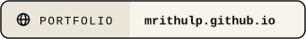</a>
  <a href="https://www.linkedin.com/in/mrithul-padinhattayil-b1251a3aa/">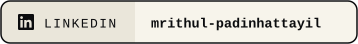</a>
  

<!-- ===== 01 ABOUT | title banner + intro card ===== -->
<picture>
  <source media="(prefers-color-scheme: dark)" srcset="assets/title-about-dark.svg">
  
</picture>

<!-- ===== 02 FOCUS | what I'm currently exploring ===== -->
<picture>
  <source media="(prefers-color-scheme: dark)" srcset="assets/title-focus-dark.svg">
  
</picture>

<!-- ===== 03 SELECTED WORK | title banner ===== -->
<picture>
  <source media="(prefers-color-scheme: dark)" srcset="assets/title-work-dark.svg">
  
</picture>

<!-- Project 1: TripTrack (web app) -->
<a href="https://github.com/MrithulP?tab=repositories"></a>

<!-- Project 2: TaskFlow (web app) -->
<a href="https://github.com/MrithulP?tab=repositories"></a>

<!-- Project 3: Unleashed (Unreal Engine game prototype) -->
<a href="https://github.com/MrithulP?tab=repositories"></a>

<!-- Project 4: Beyond Object Detection (research paper) -->
<a href="https://github.com/MrithulP?tab=repositories"></a>

<!-- Project 5: Clubs Portal (web app) -->
<a href="https://github.com/MrithulP?tab=repositories"></a>

<!-- Project 6: More builds (Tic Tac Toe, Finance Analyzer, Appointment Booking) -->

<!-- ===== 04 TOOLKIT | languages, data and AI, web, tools ===== -->
<picture>
  <source media="(prefers-color-scheme: dark)" srcset="assets/title-toolkit-dark.svg">
  
</picture>

<!-- ===== 05 COMMIT LOG | title banner ===== -->
<picture>
  <source media="(prefers-color-scheme: dark)" srcset="assets/title-commits-dark.svg">
  
</picture>

<!-- Contribution snake (generated by .github/workflows/snake.yml into the "output" branch; light and dark versions) -->

  <picture>
    <source media="(prefers-color-scheme: dark)" srcset="https://raw.githubusercontent.com/MrithulP/MrithulP/output/github-contribution-grid-snake-dark.svg">
    
  </picture>

<!-- GitHub stats + top languages (github-readme-stats, themed) -->
<!--

  
  

-->

<!-- Contribution streak (themed) -->

  

<!-- ===== 06 CONNECT | title banner + bottom badges ===== -->
<picture>
  <source media="(prefers-color-scheme: dark)" srcset="assets/title-connect-dark.svg">
  
</picture>

  
  <a href="https://www.linkedin.com/in/mrithul-padinhattayil-b1251a3aa/">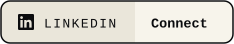</a>
  <a href="https://mrithulp.github.io">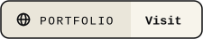</a>

<!-- ===== FOOTER SIGNATURE (assets/footer-signature.svg) ===== -->
